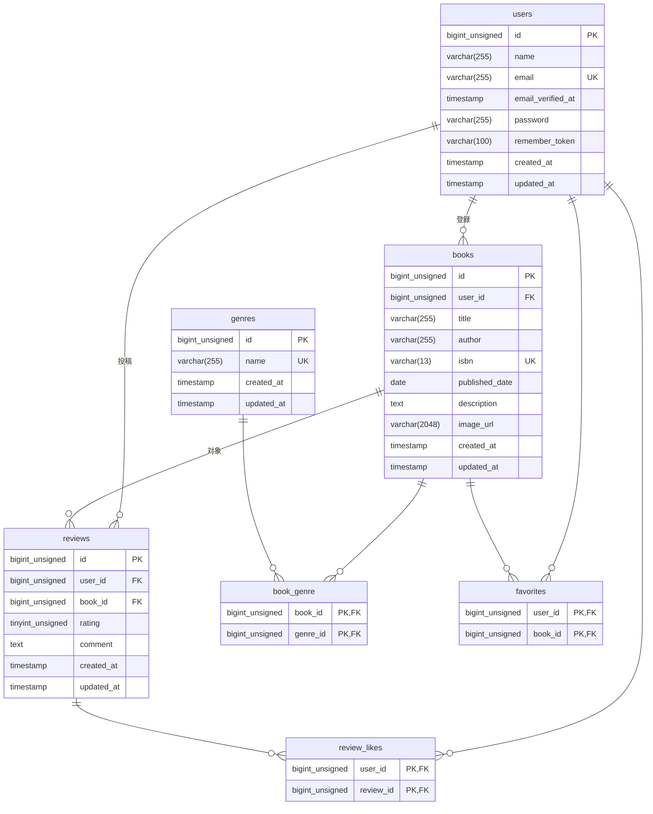

# BookShelf 書籍レビューアプリ

書籍の登録・レビュー投稿・お気に入り管理ができる、Laravel 製の書籍レビューアプリです。ブラウザ向けの Web 画面(Blade + セッション認証)と、外部アプリ向けの公開 API(JSON)の両方を備えています。

## 開発環境 URL

| 用途 | URL |
|---|---|
| アプリ | http://localhost |
| phpMyAdmin | http://localhost:8080 |
| Vite 開発サーバー | http://localhost:5173 |

## 概要

### 目的

読んだ本の感想(評価とコメント)を共有し、他の人のレビューから次に読む本を探せるようにすることを目的としています。

### 実装した機能

| 機能 | 内容 | ログイン |
|---|---|---|
| 会員登録・ログイン・ログアウト | Laravel Fortify を使用。ログイン後は元のページに戻る | - |
| 書籍一覧 | 新しい順に 10 件ずつページネーション。平均評価を表示。`/` と `/books` の両方で表示 | 不要 |
| 書籍詳細 | 書籍情報・ジャンル・レビュー一覧・平均評価を表示 | 不要 |
| 書籍の登録・編集・削除 | 編集・削除は登録者本人のみ(他人は 403) | 必要 |
| レビュー | 1 ユーザー 1 書籍につき 1 件。評価(1〜5)とコメント(任意)。編集・削除は投稿者本人のみ | 必要 |
| レビューへのいいね | トグル式。自分のレビューにはいいねできない | 必要 |
| お気に入り | 書籍のお気に入り登録・解除と一覧表示 | 必要 |
| ジャンル管理 | 一覧・詳細・登録・編集・削除。書籍が紐づくジャンルは削除不可 | 必要 |
| ランキング | 平均評価の高い順(同点はレビュー件数順)に上位 10 件 | 不要 |
| 公開 API | 書籍の一覧・詳細・登録・更新・削除(認証なし、JSON) | 不要 |

### 画面一覧

| パス | 画面 | ログイン |
|---|---|---|
| `/`、`/books` | 書籍一覧 | 不要 |
| `/books/{book}` | 書籍詳細 | 不要 |
| `/ranking` | ランキング | 不要 |
| `/register`、`/login` | 会員登録、ログイン | 不要 |
| `/books/create`、`/books/{book}/edit` | 書籍の登録、編集 | 必要 |
| `/reviews/{review}/edit` | レビューの編集 | 必要 |
| `/favorites` | お気に入り一覧 | 必要 |
| `/genres`、`/genres/create`、`/genres/{genre}`、`/genres/{genre}/edit` | ジャンル管理 | 必要 |

## ER 図



- 書籍を削除すると、レビュー・お気に入り・ジャンルの紐付けも外部キーの cascade で一緒に削除されます。
- `book_genre.genre_id` は `restrictOnDelete` のため、書籍が紐づくジャンルは削除できません。
- `reviews` は `(user_id, book_id)` の UNIQUE 制約で、1 ユーザー 1 書籍 1 レビューを保証しています。
- `book_genre`・`favorites`・`review_likes` は複合主キーで、`id` と `timestamps` を持ちません。

## 使用技術

| 分類 | 技術 | バージョン |
|---|---|---|
| 言語 | PHP | 8.5(Sail の実行環境) |
| フレームワーク | Laravel | 10.50(`^10.10`) |
| データベース | MySQL | 8.4 |
| 認証 | Laravel Fortify | 1.36 |
| コンテナ | Docker / Docker Compose / Laravel Sail | Sail 1.69 |
| DB 管理 | phpMyAdmin | latest |
| フロントエンド | Vite | ^5.0 |
| | Tailwind CSS(+ `@tailwindcss/forms`) | ^3.4 |
| | Alpine.js | ^3.17 |
| テスト | PHPUnit | ^10.1 |
| コード整形 | Laravel Pint | 1.30 |

※ Laravel Sanctum も導入済みですが、基本機能では使用していません。
※ 実際のバージョンは `composer.lock` と `package.json` を参照してください。

## 環境構築手順

前提: Docker(Docker Desktop など)と Git がインストールされていること。

### 1. リポジトリを取得する

```bash
git clone https://github.com/Saito-N01/bookshelf-app.git
cd bookshelf-app
```

### 2. `.env` を作成する

```bash
cp .env.example .env
```

`.env.example` には Sail 用の DB 設定(`DB_HOST=mysql`、`DB_USERNAME=sail`、`DB_PASSWORD=password`)がすでに入っているため、そのまま使えます。`DB_HOST` は `127.0.0.1` ではなく、Docker のコンテナ名 `mysql` です。

### 3. Composer の依存パッケージをインストールする

PHP がローカルになくても、Docker で実行できます。

```bash
docker run --rm -u "$(id -u):$(id -g)" -v "$(pwd):/var/www/html" -w /var/www/html -e COMPOSER_CACHE_DIR=/tmp/composer_cache laravelsail/php82-composer:latest composer install --ignore-platform-reqs
```

### 4. Sail を起動する

```bash
./vendor/bin/sail up -d
```

初回はイメージのビルドに数分かかります。Apple Silicon(M1/M2/M3)の Mac は `compose.yaml` の mysql サービスに `platform: linux/amd64` を指定済みです。

以降のコマンドを `sail` だけで実行できるよう、エイリアスを設定しておくと便利です(設定しない場合は `./vendor/bin/sail` に読み替えてください)。

```bash
echo "alias sail='[ -f sail ] && bash sail || bash vendor/bin/sail'" >> ~/.zshrc
exec $SHELL
```

### 5. アプリケーションキーを生成する

```bash
sail artisan key:generate
```

### 6. マイグレーションと初期データの投入

```bash
sail artisan migrate --seed
```

やり直す場合(データはすべて消えます):

```bash
sail artisan migrate:fresh --seed
```

### 7. フロントエンドをセットアップする

```bash
sail npm install
sail npm run dev
```

`sail npm run dev` は開発中ずっと起動したままにしてください。画面のスタイルは Vite が配信します。

### 8. 動作を確認する

ブラウザで http://localhost を開き、書籍一覧が表示されれば完了です。

### ログイン用のテストユーザー

`migrate --seed` で次の 5 ユーザーが作成されます。パスワードはすべて `password` です。

| 名前 | メールアドレス |
|---|---|
| 山田太郎 | yamada@example.com |
| 鈴木花子 | suzuki@example.com |
| 田中一郎 | tanaka@example.com |
| 佐藤美咲 | sato@example.com |
| 高橋健太 | takahashi@example.com |

あわせて、ジャンル 10 件、書籍 11 件、レビュー 32 件、お気に入り、レビューへのいいねも投入されます。

## テストとコード整形

```bash
# テスト実行
sail artisan test

# カバレッジ付きで実行
sail artisan test --coverage

# コード整形の確認(「No fixable issues were found」と表示されれば OK)
sail bin pint --test

# コード整形の実行
sail bin pint
```

テストは SQLite のインメモリ DB で実行されるため、開発用の MySQL のデータには影響しません。

## API エンドポイント一覧

認証なしで利用できる JSON API です。ベース URL は `http://localhost/api/v1` です。

| メソッド | パス | 概要 | 成功時 |
|---|---|---|---|
| GET | `/api/v1/books` | 書籍一覧を取得(絞り込み・ページネーション対応) | 200 |
| GET | `/api/v1/books/{book}` | 書籍詳細を取得(ジャンル・レビュー付き) | 200 |
| POST | `/api/v1/books` | 書籍を登録 | 201 |
| PUT | `/api/v1/books/{book}` | 書籍を更新(`user_id` は変更不可) | 200 |
| DELETE | `/api/v1/books/{book}` | 書籍を削除(レビュー・お気に入り・ジャンル紐付けも削除) | 204(ボディなし) |

### 一覧のクエリパラメータ(`GET /api/v1/books`)

| パラメータ | 型 | 説明 |
|---|---|---|
| `keyword` | string | タイトル・著者名の部分一致 |
| `genre_id` | integer | ジャンル ID で絞り込み |
| `page` | integer | ページ番号(デフォルト 1) |
| `per_page` | integer | 1 ページの件数(デフォルト 20、最大 100) |

レスポンスは `data` / `links` / `meta` の形式です。各書籍にはジャンル・平均評価・レビュー件数が含まれます。

### エラーレスポンス(日本語)

| ステータス | 内容 |
|---|---|
| 404 | `{"message": "書籍が見つかりません。"}` |
| 422 | バリデーションエラー(`message` と `errors`) |

### リクエスト例

```bash
# 一覧(キーワード検索)
curl "http://localhost/api/v1/books?keyword=夏目&per_page=10" -H "Accept: application/json"

# 登録(ジャンルは genre_ids、登録者は user_id で指定)
curl -X POST http://localhost/api/v1/books \
  -H "Accept: application/json" -H "Content-Type: application/json" \
  -d '{"user_id":1,"title":"サンプル","author":"著者名","isbn":"9784000000000","published_date":"2024-01-01","genre_ids":[1]}'
```

## 作成者

Saito-N01(https://github.com/Saito-N01)
