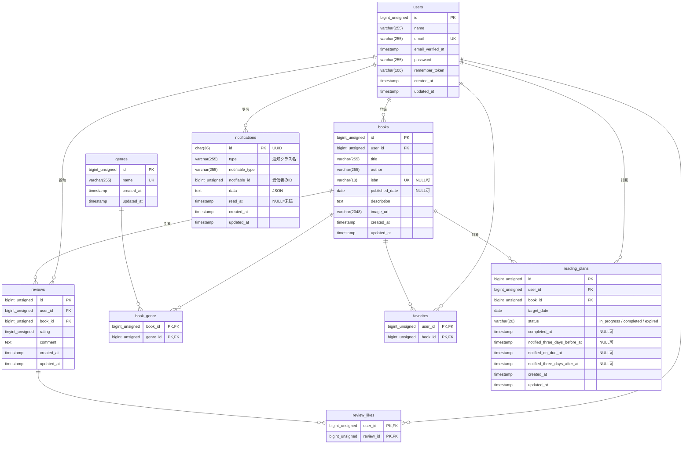

# BookShelf 書籍レビューアプリ

書籍の登録・レビュー投稿・お気に入り管理ができる、Laravel 製の書籍レビューアプリです。ブラウザ向けの Web 画面(Blade + セッション認証)と、外部アプリ向けの公開 API(JSON)の両方を備えています。

## 開発環境 URL

| 用途 | URL |
|---|---|
| アプリ | http://localhost |
| phpMyAdmin | http://localhost:8080 |
| Vite 開発サーバー | http://localhost:5173 |

## 概要

### 目的

読んだ本の感想(評価とコメント)を共有し、他の人のレビューから次に読む本を探せるようにすることを目的としています。

### 実装した機能

| 機能 | 内容 | ログイン |
|---|---|---|
| 会員登録・ログイン・ログアウト | Laravel Fortify を使用。ログイン後は元のページに戻る | - |
| 書籍一覧 | 10 件ずつページネーション。平均評価を表示。キーワード検索(タイトル・著者名)、ジャンル絞り込み、並び替え(新しい順・古い順・タイトル順・評価順)に対応。`/` と `/books` の両方で表示 | 不要 |
| 書籍詳細 | 書籍情報・ジャンル・レビュー一覧・平均評価を表示 | 不要 |
| 書籍の登録・編集・削除 | 編集・削除は登録者本人のみ(他人は 403)。ISBN と出版日は任意 | 必要 |
| ISBN 検索 | 登録・編集画面で ISBN(13 桁)を入力すると、Google Books API から書籍情報を取得してフォームに自動入力 | 必要 |
| レビュー | 1 ユーザー 1 書籍につき 1 件。評価(1〜5)とコメント(任意)。編集・削除は投稿者本人のみ | 必要 |
| レビューへのいいね | トグル式。自分のレビューにはいいねできない | 必要 |
| お気に入り | 書籍のお気に入り登録・解除と一覧表示 | 必要 |
| ジャンル管理 | 一覧・詳細・登録・編集・削除。書籍が紐づくジャンルは削除不可 | 必要 |
| ランキング | 平均評価の高い順(同点はレビュー件数順)に上位 10 件 | 不要 |
| 読書計画 | 自分が登録した書籍に「いつまでに読むか」の期日を設定。一覧(状態で絞り込み)・登録・期日の変更・読了・削除。状態は進行中・完了・期限切れの 3 つで、同じ書籍の進行中の計画は 1 件まで。完了済みの計画は変更不可 | 必要 |
| マイ読書レポート | 自分のレビューを集計し、総レビュー数・読了冊数(レビューした書籍数)・平均評価、評価分布(1〜5)、高評価書籍 TOP5(評価 4 以上)、ジャンル別評価傾向 TOP5 を表示 | 必要 |
| 日次バッチ | 毎日 20:00 に、期日を過ぎた進行中の計画を期限切れに更新し、リマインダー通知を送信(同じ通知は二重に送らない) | - |
| 通知 | 読書計画のリマインダー(期日の 3 日前・当日・3 日後)を通知一覧に表示。未読は「未読」バッジで区別し、「既読にする」で既読化。ヘッダーのベルアイコンに未読件数を表示 | 必要 |
| 公開 API | 書籍の一覧・詳細・登録・更新・削除(JSON)。一覧・詳細は認証なし、登録・更新・削除は Laravel Sanctum のトークン認証が必要(更新・削除は登録者本人のみ) | 読み取りは不要 |

### 画面一覧

| パス | 画面 | ログイン |
|---|---|---|
| `/`、`/books` | 書籍一覧 | 不要 |
| `/books/{book}` | 書籍詳細 | 不要 |
| `/ranking` | ランキング | 不要 |
| `/register`、`/login` | 会員登録、ログイン | 不要 |
| `/books/create`、`/books/{book}/edit` | 書籍の登録、編集 | 必要 |
| `/reviews/{review}/edit` | レビューの編集 | 必要 |
| `/favorites` | お気に入り一覧 | 必要 |
| `/reading-plans`、`/reading-plans/create`、`/reading-plans/{plan}/edit` | 読書計画の一覧、作成、編集 | 必要 |
| `/reports` | マイ読書レポート | 必要 |
| `/notifications` | 通知一覧 | 必要 |
| `/genres`、`/genres/create`、`/genres/{genre}`、`/genres/{genre}/edit` | ジャンル管理 | 必要 |

## ER 図



- 書籍を削除すると、レビュー・お気に入り・ジャンルの紐付けも外部キーの cascade で一緒に削除されます。
- `book_genre.genre_id` は `restrictOnDelete` のため、書籍が紐づくジャンルは削除できません。
- `reviews` は `(user_id, book_id)` の UNIQUE 制約で、1 ユーザー 1 書籍 1 レビューを保証しています。
- `book_genre`・`favorites`・`review_likes` は複合主キーで、`id` と `timestamps` を持ちません。
- `reading_plans.status` は PHP の Enum(`App\Enums\ReadingPlanStatus`)で管理し、進行中・完了・期限切れの 3 つの状態を持ちます。ユーザーまたは書籍を削除すると、その読書計画も cascade で削除されます。
- `reading_plans.notified_*_at` はリマインダー通知の送信日時で、同じ通知を二重に送らないための判定に使います。
- `notifications` は Laravel 標準の通知テーブルです。`data` には `timing`(three_days_before / on_due_date / three_days_after)・`title`・`body`・`plan_id`・`book_title`・`target_date` を JSON で保存します。
- `books.isbn` と `books.published_date` は NULL 可です(ISBN のない書籍や、出版日が不明な書籍も登録できます)。`isbn` の UNIQUE 制約では NULL は重複とみなされません。

## 使用技術

| 分類 | 技術 | バージョン |
|---|---|---|
| 言語 | PHP | 8.5(Sail の実行環境) |
| フレームワーク | Laravel | 10.50(`^10.10`) |
| データベース | MySQL | 8.4 |
| 認証 | Laravel Fortify(Web 画面) | 1.36 |
| | Laravel Sanctum(公開 API のトークン認証) | ^3.3 |
| コンテナ | Docker / Docker Compose / Laravel Sail | Sail 1.69 |
| DB 管理 | phpMyAdmin | latest |
| フロントエンド | Vite | ^5.0 |
| | Tailwind CSS(+ `@tailwindcss/forms`) | ^3.4 |
| | Alpine.js | ^3.17 |
| 外部 API | Google Books API(ISBN 検索) | v1 |
| DB スキーマ変更 | doctrine/dbal(カラム変更のマイグレーションに使用) | 3.10(`^3.7`) |
| テスト | PHPUnit | ^10.1 |
| コード整形 | Laravel Pint | 1.30 |

※ 実際のバージョンは `composer.lock` と `package.json` を参照してください。

## 環境構築手順

前提: Docker(Docker Desktop など)と Git がインストールされていること。

### 1. リポジトリを取得する

```bash
git clone https://github.com/Saito-N01/bookshelf-app.git
cd bookshelf-app
```

### 2. `.env` を作成する

```bash
cp .env.example .env
```

`.env.example` には Sail 用の DB 設定(`DB_HOST=mysql`、`DB_USERNAME=sail`、`DB_PASSWORD=password`)がすでに入っているため、そのまま使えます。`DB_HOST` は `127.0.0.1` ではなく、Docker のコンテナ名 `mysql` です。

#### Google Books API キーを設定する(ISBN 検索を使う場合)

ISBN 検索は Google Books API を利用します。API キーなしでも呼び出せますが、キーなしのアクセスは利用回数の上限に達しやすく、「書籍情報を取得できませんでした。時間をおいて再度お試しください。」と表示されることがあります。次の手順で API キー(無料)を設定してください。

1. [Google Cloud Console](https://console.cloud.google.com/) でプロジェクトを作成(または選択)する
2. 「API とサービス」→「ライブラリ」で **Books API** を検索し、有効にする
3. 「API とサービス」→「認証情報」→「認証情報を作成」→「API キー」でキーを発行する
4. `.env` の `GOOGLE_BOOKS_API_KEY` に発行したキーを設定する

```
GOOGLE_BOOKS_API_URL=https://www.googleapis.com/books/v1/volumes
GOOGLE_BOOKS_API_KEY=発行したAPIキー
```

API キーは `.env` にだけ記載し、`.env.example` やコードには書かないでください。Sail の起動後に `.env` を変更して反映されない場合は、`sail artisan config:clear` を実行してください。

### 3. Composer の依存パッケージをインストールする

PHP がローカルになくても、Docker で実行できます。

```bash
docker run --rm -u "$(id -u):$(id -g)" -v "$(pwd):/var/www/html" -w /var/www/html -e COMPOSER_CACHE_DIR=/tmp/composer_cache laravelsail/php82-composer:latest composer install --ignore-platform-reqs
```

### 4. Sail を起動する

```bash
./vendor/bin/sail up -d
```

初回はイメージのビルドに数分かかります。Apple Silicon(M1/M2/M3)の Mac は `compose.yaml` の mysql サービスに `platform: linux/amd64` を指定済みです。

以降のコマンドを `sail` だけで実行できるよう、エイリアスを設定しておくと便利です(設定しない場合は `./vendor/bin/sail` に読み替えてください)。

```bash
echo "alias sail='[ -f sail ] && bash sail || bash vendor/bin/sail'" >> ~/.zshrc
exec $SHELL
```

### 5. アプリケーションキーを生成する

```bash
sail artisan key:generate
```

### 6. マイグレーションと初期データの投入

```bash
sail artisan migrate --seed
```

やり直す場合(データはすべて消えます):

```bash
sail artisan migrate:fresh --seed
```

### 7. フロントエンドをセットアップする

```bash
sail npm install
sail npm run dev
```

`sail npm run dev` は開発中ずっと起動したままにしてください。画面のスタイルは Vite が配信します。

### 8. 動作を確認する

ブラウザで http://localhost を開き、書籍一覧が表示されれば完了です。

### ログイン用のテストユーザー

`migrate --seed` で次の 5 ユーザーが作成されます。パスワードはすべて `password` です。

| 名前 | メールアドレス |
|---|---|
| 山田太郎 | yamada@example.com |
| 鈴木花子 | suzuki@example.com |
| 田中一郎 | tanaka@example.com |
| 佐藤美咲 | sato@example.com |
| 高橋健太 | takahashi@example.com |

あわせて、ジャンル 10 件、書籍 11 件、レビュー 32 件、お気に入り、レビューへのいいね、読書計画 6 件も投入されます。読書計画の期日は、シーダーを実行した日を起点に設定されます(山田太郎に 5 件、鈴木花子に 1 件)。

## テストとコード整形

```bash
# テスト実行
sail artisan test

# カバレッジ付きで実行
sail artisan test --coverage

# コード整形の確認(「No fixable issues were found」と表示されれば OK)
sail bin pint --test

# コード整形の実行
sail bin pint
```

テストは SQLite のインメモリ DB で実行されるため、開発用の MySQL のデータには影響しません。

## 日次バッチ(読書計画のリマインダー)

読書計画の期限切れへの更新と、リマインダー通知の送信を 1 つのコマンドで行います。

```bash
# 手動で実行する
sail artisan reading-plans:notify

# スケジュールを動かす(毎日 20:00 に自動で実行される。起動したままにする)
sail artisan schedule:work

# 登録されているスケジュールを確認する
sail artisan schedule:list
```

コマンドは次の順に処理します。

1. 期日を過ぎた進行中の計画を「期限切れ」に更新する(期日が当日の計画は対象外)
2. リマインダー通知を送信する

| 通知 | 対象 |
|---|---|
| 期日の 3 日前 | 期日が 3 日後の、進行中の計画 |
| 期日の当日 | 期日が当日の、進行中の計画 |
| 期日の 3 日後 | 期日が 3 日前の、期限切れの計画 |

- 通知は `notifications` テーブルに保存され(DatabaseChannel)、通知一覧とヘッダーのベルアイコンに表示されます。
- 送信した日時を `reading_plans.notified_*_at` に記録するため、同じ日にコマンドを再実行しても同じ通知は二重に送られません。
- 完了済みの計画には通知を送りません。期日を変更すると送信日時がリセットされ、新しい期日に合わせてもう一度通知されます。
- スケジュールの時刻は `app/Console/Kernel.php` で設定しています(毎日 20:00、Asia/Tokyo)。

初期データ(`migrate:fresh --seed` の直後)でコマンドを実行すると、山田太郎に 3 件の通知(3 日前・当日・3 日後)が届き、期日を 3 日過ぎた計画が「期限切れ」に変わります。

## ISBN 検索(Google Books API)

書籍の登録・編集画面の「ISBN で検索」から呼び出される、ログイン必須のエンドポイントです。Google Books API の接続先と API キーは `.env`(`GOOGLE_BOOKS_API_URL` / `GOOGLE_BOOKS_API_KEY`)で管理しています。

| メソッド | パス | 概要 |
|---|---|---|
| GET | `/books/isbn/{isbn}` | ISBN(13 桁)から書籍情報を取得して JSON で返す |

| ステータス | 内容 |
|---|---|
| 200 | `{"title": "...", "author": "...", "published_date": "2012-06-23", "description": "...", "image_url": "..."}` |
| 404 | `{"error": "該当する書籍が見つかりませんでした。"}` |
| 422 | `{"error": "ISBNは13桁の数字で入力してください。"}` |
| 503 | `{"error": "書籍情報を取得できませんでした。時間をおいて再度お試しください。"}`(Google Books API に接続できない、または回数上限) |

- 著者が複数いる場合は「、」でつなげて返します。
- 出版日が「2012」「2012-06」のように年月日がそろっていない場合は `null` を返します(出版日は未入力のまま登録できます)。
- 取得できなかった項目は `null` になります。

## API エンドポイント一覧

外部アプリ向けの JSON API です。ベース URL は `http://localhost/api/v1` です。

読み取り(GET)は認証なしで利用できます。書き込み(POST / PUT / DELETE)は Laravel Sanctum のトークン認証が必要で、ログイン API で取得したトークンを `Authorization: Bearer {token}` ヘッダーで送ります。

| メソッド | パス | 概要 | 認証 | 成功時 |
|---|---|---|---|---|
| POST | `/api/v1/login` | ログイン(トークンを発行) | 不要 | 200 |
| GET | `/api/v1/books` | 書籍一覧を取得(絞り込み・ページネーション対応) | 不要 | 200 |
| GET | `/api/v1/books/{book}` | 書籍詳細を取得(ジャンル・レビュー付き) | 不要 | 200 |
| POST | `/api/v1/books` | 書籍を登録(登録者は認証ユーザー) | 必要 | 201 |
| PUT | `/api/v1/books/{book}` | 書籍を更新(登録者本人のみ) | 必要 | 200 |
| DELETE | `/api/v1/books/{book}` | 書籍を削除(登録者本人のみ。レビュー・お気に入り・ジャンル紐付けも削除) | 必要 | 204(ボディなし) |

### ログイン(`POST /api/v1/login`)

`email` と `password` を送ると、トークンとユーザー情報を返します。

```json
{
  "token": "1|xxxxxxxx",
  "user": {"id": 1, "name": "山田太郎", "email": "yamada@example.com"}
}
```

- 書籍の登録では、登録者(`user_id`)はリクエストから受け取らず、トークンで認証されたユーザーになります。
- 書籍の更新・削除は、Web 画面と同じ `BookPolicy` で登録者本人だけに許可しています。

### 一覧のクエリパラメータ(`GET /api/v1/books`)

| パラメータ | 型 | 説明 |
|---|---|---|
| `keyword` | string | タイトル・著者名の部分一致 |
| `genre_id` | integer | ジャンル ID で絞り込み |
| `page` | integer | ページ番号(デフォルト 1) |
| `per_page` | integer | 1 ページの件数(デフォルト 20、最大 100) |

レスポンスは `data` / `links` / `meta` の形式です。各書籍にはジャンル・平均評価・レビュー件数が含まれます。

### エラーレスポンス(日本語)

| ステータス | 内容 |
|---|---|
| 401 | `{"message": "認証が必要です。"}`(トークンがない・無効、またはログインのメールアドレス・パスワードが誤っている) |
| 403 | `{"message": "この操作を行う権限がありません。"}`(他人の書籍の更新・削除) |
| 404 | `{"message": "書籍が見つかりません。"}` |
| 422 | バリデーションエラー(`message` と `errors`) |

### リクエスト例

```bash
# 一覧(キーワード検索)
curl "http://localhost/api/v1/books?keyword=夏目&per_page=10" -H "Accept: application/json"

# ログイン(レスポンスの token を、以降の書き込みで使う)
curl -X POST http://localhost/api/v1/login \
  -H "Accept: application/json" -H "Content-Type: application/json" \
  -d '{"email":"yamada@example.com","password":"password"}'

# 登録(ジャンルは genre_ids で指定。isbn と published_date は省略可)
curl -X POST http://localhost/api/v1/books \
  -H "Accept: application/json" -H "Content-Type: application/json" \
  -H "Authorization: Bearer 取得したトークン" \
  -d '{"title":"サンプル","author":"著者名","isbn":"9784000000000","published_date":"2024-01-01","genre_ids":[1]}'

# 削除(自分が登録した書籍のみ)
curl -X DELETE http://localhost/api/v1/books/1 \
  -H "Accept: application/json" -H "Authorization: Bearer 取得したトークン"
```

## 作成者

Saito-N01(https://github.com/Saito-N01)
